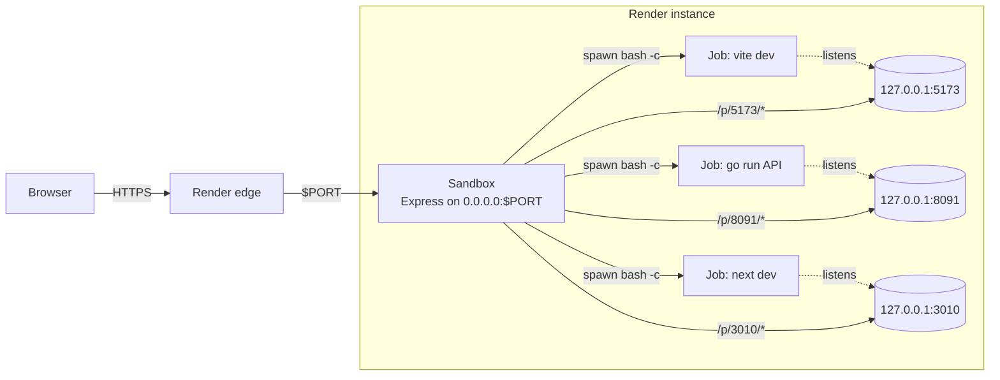
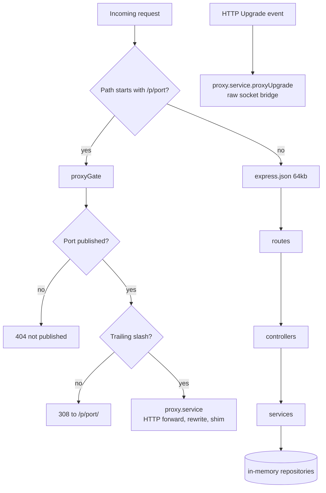

# machine-orchestrator

**Run shell commands inside a Render web service from your browser, start any server you like, and open it through the same public URL.**

Live at **[machine-orchestrator.onrender.com](https://machine-orchestrator.onrender.com/)**.

Render gives each web service one public hostname and forwards it to a single port (`$PORT`). Anything else you start on that machine stays on localhost. machine-orchestrator is the service on `$PORT`. It runs your commands, finds the servers they start, and reverse-proxies each published port at `/p/<port>/`. One Render URL can serve many apps.

```text
https://machine-orchestrator.onrender.com/          the UI and command API
https://machine-orchestrator.onrender.com/p/5173/   a Vite app you started from the UI
https://machine-orchestrator.onrender.com/p/8091/   a Go API you built from the UI
https://machine-orchestrator.onrender.com/p/3010/   a Next.js frontend you built from the UI
```

> [!WARNING]
> No authentication is enforced. Anyone who has the URL can run any shell command as the service user. Deploy it only as a private, disposable sandbox, and never on a service that has secrets in its environment.

---

## Contents

- [Features](#features)
- [Architecture](#architecture)
- [How a request is routed](#how-a-request-is-routed)
- [Strip mode versus keep-prefix mode](#strip-mode-versus-keep-prefix-mode)
- [Project structure](#project-structure)
- [API reference](#api-reference)
- [Getting started](#getting-started)
- [Recipes](#recipes)
- [Limits](#limits)
- [Things to know about Render](#things-to-know-about-render)
- [Troubleshooting](#troubleshooting)

---

## Features

### Running commands

- **Shell from the browser.** Each command runs in `/bin/bash -c` in its own process group. Press **Ctrl + Enter** to run.
- **Background jobs.** Long-running commands such as `npm run dev` keep running after the request returns. The UI polls their output.
- **Job history.** The last 40 jobs are kept in memory, each with its status, exit code, PID, working directory, start and end time, and output.
- **Kill.** Kill sends `SIGTERM` to the whole process group, then `SIGKILL` after 1.5 seconds, so child processes like `npm → node → vite` stop too.
- **Bounded output.** Each job keeps up to 300 KB of combined stdout and stderr. Older output is dropped and the job is flagged `truncated`.
- **Workspace.** Commands start in `workspace/` by default. Pass `cwd` to use a relative or absolute directory instead.
- **One-click suggestions.** Buttons for the Node version, `ls`, `pwd`, `uname`, scaffolding Create React App or Vite, starting each one, and a hello-world server on 8080.

### Publishing services

- **Path proxy.** `/p/<port>/` forwards to `127.0.0.1:<port>`, or to `[::1]:<port>` when the app only listens on IPv6 loopback.
- **Opt-in exposure.** A port is reachable only after you publish it. Unpublished ports return 404, so this is not an open proxy.
- **Port detection.** The sandbox walks the process tree of every running job and lists the TCP ports those processes listen on. It reads `/proc` on Linux and falls back to `lsof` on macOS. Each detected port gets a **Publish** button.
- **Live status.** Published routes show online or offline, refreshed every 2 seconds.
- **Self-protection.** You can't publish the sandbox's own port.

### Proxy behavior

- **HTTP and WebSocket.** Upgrade requests are piped both ways, so hot-module reload, Socket.IO, and other live connections work.
- **Two modes.** Strip mode removes `/p/<port>` before forwarding. Keep-prefix mode forwards the full path for apps that already use that base path. See [Strip mode versus keep-prefix mode](#strip-mode-versus-keep-prefix-mode).
- **HTML and CSS rewriting** (strip mode). Root-relative `href`, `src`, `action`, `poster`, `formaction`, `srcset`, and CSS `url(/...)` values are prefixed with `/p/<port>`. Gzip, deflate, and Brotli bodies are decoded before rewriting.
- **Runtime shim** (strip mode). A small script injected into HTML pages patches `fetch`, `XMLHttpRequest`, `WebSocket`, `EventSource`, `history.pushState` and `replaceState`, `setAttribute`, and the `src`/`href` setters, so URLs built in JavaScript also stay under the prefix.
- **Redirects.** `Location: /login` becomes `/p/<port>/login`. Absolute redirects to `localhost:<port>` are rewritten to the public host.
- **Cookies.** `Set-Cookie` with `Path=/` is scoped to `Path=/p/<port>/`, so two apps can't overwrite each other's cookies.
- **Trailing slash.** `/p/5173` redirects with a 308 to `/p/5173/`, so relative URLs resolve under the prefix.
- **Host header.** Upstreams receive `Host: 127.0.0.1:<port>`, which passes Vite's `allowedHosts` check. The original host, protocol, client IP, and prefix are sent in the `X-Forwarded-*` headers.
- **Streaming.** Responses that aren't rewritten, along with SSE and bodies over 1.5 MB, stream straight through without buffering.
- **Clear errors.** When nothing is listening on the port, the sandbox shows a 502 page that says so instead of hanging.

### Diagnostics

- **Probe** one port: whether TCP is open, plus the HTTP status and a short body preview.
- **Scan** up to 20 ports at once.
- **Listeners**: every listening TCP socket on the machine, from `/proc/net/tcp` and `tcp6`, or from `lsof`.
- **Meta**: the sandbox port, hostname, Node version, platform, and workspace path.

### Engineering

- One runtime dependency: Express 4. The proxy, WebSocket bridge, port detection, and rewriting are built on Node's `http`, `net`, `zlib`, and `child_process`.
- Layered layout: routes, controllers, services, repositories, config, constants, and utils.
- Security headers on sandbox pages: a strict CSP, `X-Frame-Options: DENY`, `nosniff`, `no-referrer`, and `no-store`.
- The JSON body limit is 64 KB, with clean 400 and 413 errors. `x-powered-by` and ETags are turned off.

---

## Architecture



Inside the sandbox, each request goes through one of two paths:



The proxy gate runs **before** `express.json()`. If the order were reversed, the JSON parser would consume the request body of every proxied `POST` and the upstream app would receive an empty body.

WebSocket upgrades never reach Express. `src/server.js` listens for the HTTP server's `upgrade` event and hands the raw socket to `proxyUpgrade`.

### Layers

| Layer | What it does |
| --- | --- |
| `routes/` | Maps URLs to controllers. |
| `controllers/` | Validates input, calls services, writes responses. |
| `services/` | Spawns and kills jobs, detects listeners, probes ports, publishes routes, and proxies traffic. |
| `repositories/` | In-memory `Map` stores for jobs, routes, and the cache of which upstream host answered. |
| `config/` | Port, workspace path, body limit, timeouts. |
| `constants/` | Limits, hop-by-hop headers, security headers. |
| `utils/` | HTTP helpers, async wrapper, errors, port validation. |

All state lives in memory, so restarting the sandbox clears jobs and published routes.

---

## How a request is routed

Take `GET https://machine-orchestrator.onrender.com/p/4000/todos` with port 4000 published in strip mode:

1. Render forwards the request to the sandbox on `$PORT`.
2. `proxyGate` matches `/p/4000`, finds the route, and confirms the path has a trailing slash.
3. `upstreamHost(4000)` checks `127.0.0.1`, then `::1`, and caches the answer for 4 seconds.
4. The `/p/4000` prefix is removed, so the upstream receives `GET /todos` with `Host: 127.0.0.1:4000` and the `X-Forwarded-*` headers.
5. A JSON response streams back unchanged. An HTML response is buffered, its root URLs are rewritten, the shim is injected, and `Content-Length` is recalculated.
6. Any `Location` or `Set-Cookie` header is rewritten to stay under `/p/4000/`.

---

## Strip mode versus keep-prefix mode

| | Strip (default, box checked) | Keep prefix (box unchecked) |
| --- | --- | --- |
| Upstream sees | `/todos` | `/p/4000/todos` |
| Use for | Apps that serve from `/`: Express, Go, Flask, Create React App | Apps started with a base path: Vite `--base /p/5173/`, Next.js `basePath: "/p/3010"` |
| HTML/CSS rewriting and shim | Yes | No, the app already emits correct URLs |
| Cookie path rewrite | Yes | No |

**Rule of thumb:** if you told the framework its base path is `/p/<port>`, uncheck the box. Otherwise leave it checked.

---

## Project structure

```text
machine-orchestrator/
├── server.js                    entry point, requires src/server
├── package.json                 express ^4.21.2, node >= 20
├── public/
│   └── index.html               single-page UI: command box, jobs, published services
├── workspace/                   default cwd for commands (gitignored)
└── src/
    ├── server.js                listen on 0.0.0.0:$PORT, attach WebSocket upgrade handler
    ├── app.js                   createApp(): proxyGate, then json, routes, 404, error handler
    ├── config/index.js          port, workspace, indexPath, bodyLimit, requestTimeoutMs
    ├── constants/index.js       limits, HOP_HEADERS, SECURITY_HEADERS
    ├── routes/
    │   ├── index.js             mounts page routes and /api routes
    │   ├── job.routes.js        /run, /jobs, /jobs/:id, /jobs/:id/kill
    │   ├── port.routes.js       /probe, /scan, /listeners
    │   └── published.routes.js  /services, /routes, /routes/:port
    ├── controllers/
    │   ├── page.controller.js   GET /, GET /api/meta
    │   ├── job.controller.js
    │   ├── port.controller.js
    │   ├── route.controller.js
    │   └── proxy.controller.js  proxyGate middleware
    ├── services/
    │   ├── job.service.js       spawn, capture output, wait, kill process group
    │   ├── listener.service.js  process tree, /proc/net/tcp inode match, lsof fallback
    │   ├── probe.service.js     TCP connect check, HTTP GET preview
    │   ├── route.service.js     publish, unpublish, online status
    │   └── proxy.service.js     HTTP proxy, rewriting, shim, WebSocket bridge
    ├── repositories/
    │   ├── job.repository.js
    │   └── route.repository.js
    └── utils/
        ├── async-handler.js
        ├── http-error.js
        ├── http.js              send(), textPage(), escapeHtml()
        └── port.js              clampPort(), publicPath()
```

---

## API reference

All endpoints take and return JSON.

### Commands

| Method | Path | Body | Returns |
| --- | --- | --- | --- |
| `POST` | `/api/run` | `{ command, cwd?, background?, timeoutMs? }` | The job, with its full output so far. |
| `GET` | `/api/jobs` | | `{ jobs }`, newest first, each with a 1,200-character output preview. |
| `GET` | `/api/jobs/:id` | | One job with its full output. |
| `POST` | `/api/jobs/:id/kill` | | `{ killed, job }` |

`timeoutMs` sets how long the request waits for the command to finish, from 0 to 55,000 ms (default 20,000). The command keeps running after that, and you can read its output from `/api/jobs/:id`. With `background: true`, the request returns immediately.

```bash
curl -s https://machine-orchestrator.onrender.com/api/run \
  -H 'content-type: application/json' \
  -d '{"command":"node -v && ls","timeoutMs":10000}'
```

### Publishing

| Method | Path | Body | Returns |
| --- | --- | --- | --- |
| `GET` | `/api/services` | | `{ listeners, routes }`: ports detected from jobs, and the published routes with their online status. |
| `POST` | `/api/routes` | `{ port, strip?, label? }` | The published route. |
| `DELETE` | `/api/routes/:port` | | `{ removed }` |

```bash
curl -s https://machine-orchestrator.onrender.com/api/routes \
  -H 'content-type: application/json' \
  -d '{"port":5173,"strip":false,"label":"Vite"}'
```

### Diagnostics

| Method | Path | Body | Returns |
| --- | --- | --- | --- |
| `GET` | `/api/meta` | | Port, hostname, Node version, platform, workspace. |
| `POST` | `/api/probe` | `{ port }` | Whether TCP is open, plus an HTTP status and body preview. |
| `POST` | `/api/scan` | `{ ports: [...] }` | Probe results for up to 20 ports. |
| `GET` | `/api/listeners` | | Every listening socket on the machine. |

### Errors

| Status | When |
| --- | --- |
| `400` | Empty or too-long command, invalid JSON, bad port, missing working directory, or an attempt to publish the sandbox's own port. |
| `404` | Unknown job, unpublished port, or unknown route. |
| `413` | Body larger than 64 KB. |
| `429` | 8 commands already running. |
| `502` | The published port isn't accepting connections. |

---

## Getting started

### Run locally

```bash
npm install
PORT=8787 npm start
# open http://localhost:8787
```

### Deploy to Render

1. Push this repo to GitHub.
2. In Render, create a **Web Service** from the repo.
3. Set the runtime to **Node**, the build command to `npm install`, and the start command to `npm start`.
4. Don't set `PORT` yourself. Render provides it.

There's no database or environment setup.

---

## Recipes

Each of these runs from the command box on the live service. Start the server bound to `127.0.0.1`, then publish its port.

### Vite + React

```bash
npx --yes create-vite@latest demo-vite --no-interactive --overwrite --template react
cd demo-vite && npm install --include=dev && npm run dev -- --host 127.0.0.1 --port 5173 --strictPort --base /p/5173/
```

Publish **5173** with the box **unchecked**, then open `/p/5173/`.

### Express API + React frontend on separate ports

- The API listens on `127.0.0.1:4020`. Publish it in **strip** mode so it's reachable at `/p/4020/todos`.
- The UI uses Vite with `--base /p/5180/` and calls `fetch("/p/4020/todos")`. Publish it with the box **unchecked**.

### Go API + Next.js frontend

- Go isn't on Render's Node image. Install the official tarball into `$HOME/sdk`, then build with `$HOME/sdk/go/bin/go build`.
- Run the Go server on `127.0.0.1:8091` and publish it in **strip** mode.
- Configure Next.js with `basePath: "/p/3010"` and `allowedDevOrigins: ["machine-orchestrator.onrender.com"]`, run `next dev -H 127.0.0.1 -p 3010`, and publish it with the box **unchecked**.
- If the frontend and API are on different prefixes, authenticate with a bearer token, not cookies. In strip mode the API's cookies are scoped to `/p/8091/`, so a page under `/p/3010/` won't send them.

### Writing files with commands

Use a quoted heredoc so `$`, backticks, and quotes are written literally:

```bash
cat > server.js << 'EOF'
require("http").createServer((q, s) => s.end("hi")).listen(8080, "127.0.0.1");
EOF
```

When you send this through the API, the JSON string needs real newline characters (`\n` in JSON), not a literal backslash followed by `n`.

---

## Limits

| Limit | Value |
| --- | --- |
| Command length | 8,000 characters |
| Concurrent running jobs | 8 |
| Jobs kept in history | 40 |
| Output kept per job | 300 KB |
| Maximum wait per `/api/run` | 55 s |
| Request body | 64 KB |
| Ports per scan | 20 |
| Largest body that gets rewritten | 1.5 MB, larger bodies stream unchanged |
| Upstream request timeout | 120 s |
| Route label | 80 characters |

---

## Things to know about Render

- **Memory.** The free and starter instances have **512 MB**. Installing Next.js while other dev servers are running can exceed that, and Render will restart the instance. Run one heavy install at a time, then start servers one by one.
- **The disk is temporary.** `workspace/`, `$HOME/sdk`, and installed `node_modules` are lost on every restart, redeploy, or spin-down after idling. Keep anything you need in git, or rebuild it with commands.
- **State is in memory.** Jobs, published routes, and any in-memory app data reset when the instance restarts.
- **Only `$PORT` is public.** Bind your own servers to `127.0.0.1` and publish them through the sandbox.

---

## Troubleshooting

| Symptom | Likely cause and fix |
| --- | --- |
| Blank page or 404 assets under `/p/5173/` | The app uses a base path while strip mode is on. Uncheck the box and publish again. |
| Links jump to `/something` and leave the prefix | The app serves from `/` but was published with the box unchecked. Check it. |
| `502 Nothing is accepting connections` | The server hasn't started or crashed. Check its job output, and confirm it binds `127.0.0.1` on that port. |
| Vite says "Blocked request. This host is not allowed" | Start Vite with `--host 127.0.0.1`. The proxy sends `Host: 127.0.0.1:<port>`. |
| `429 Too many running commands` | Kill a finished or stuck job. The limit is 8. |
| Apps, files, or Go disappear | The instance restarted (out of memory, redeploy, or idle). Re-run the setup commands. |
| A `POST` reaches the upstream with an empty body | Only possible if `express.json()` is moved ahead of `proxyGate` in `src/app.js`. Keep the proxy gate first. |
